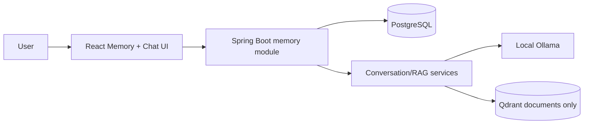
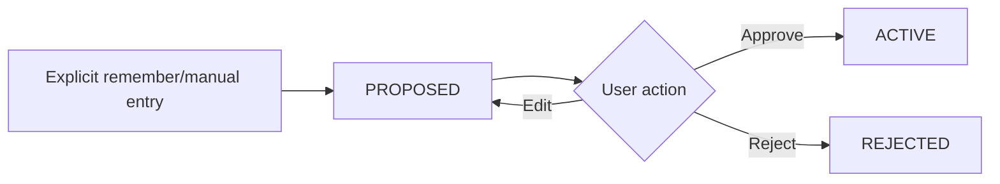
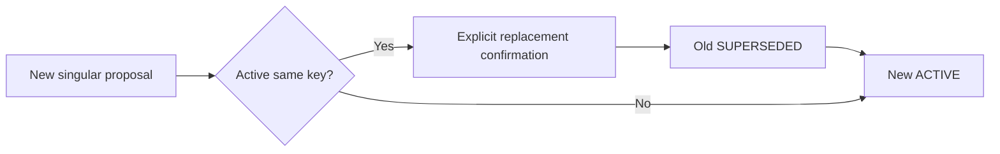
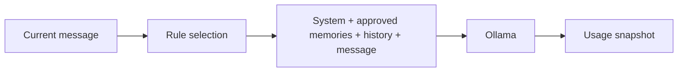
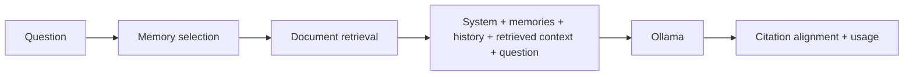
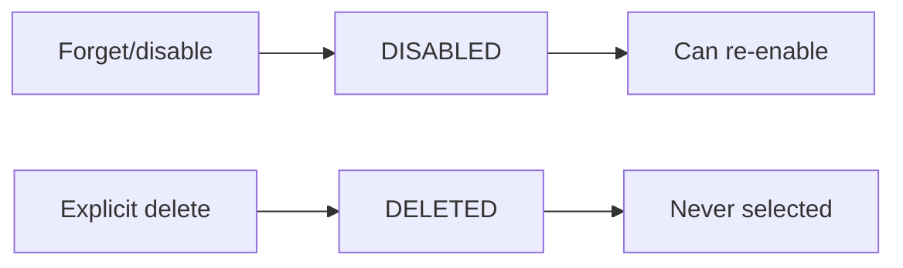
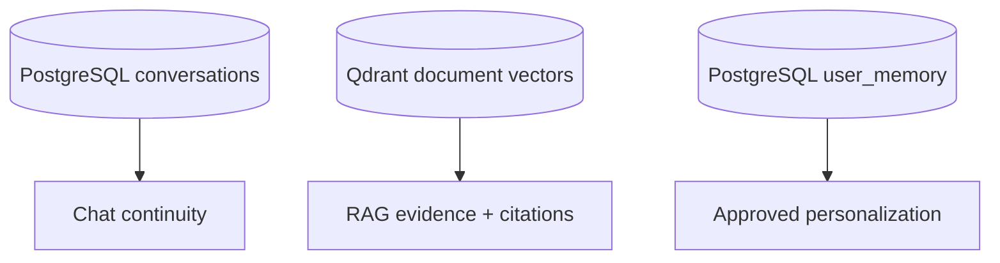
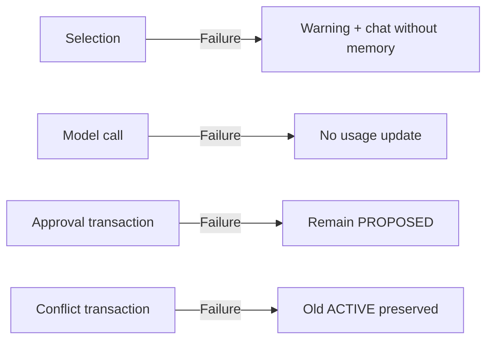

# Phase 8 memory architecture

## High-level architecture


```text
User -> React -> memory API -> PostgreSQL
                    `-> selected approved data -> Normal/RAG prompt -> Ollama
Document chunks -----------------------------------------------> Qdrant
```

## Proposal and approval


```text
request -> validate/sensitive check -> PROPOSED -> review -> approve -> ACTIVE
                                                `-> edit/reject
```

## Conflict and superseding


```text
new target_role + active target_role -> 409 conflict -> confirm -> old SUPERSEDED + new ACTIVE
```

## Normal chat with memory


```text
message -> ACTIVE/non-expired deterministic selection -> bounded prompt -> model success -> usage update
```

## RAG chat with memory


```text
question -> memory rules + Qdrant evidence -> grounded prompt -> answer -> backend citations + memory disclosure
```

## Forget and delete


```text
forget -> confirm match -> DISABLED (reversible)
delete -> DELETED marker -> excluded permanently
```

## Three persistence models


```text
messages != document chunks != personal memory
continuity   evidence           approved personalization
```

## Failure flow


```text
selection failure -> safe unpersonalized chat
generation failure -> preserve existing failure behavior; no usage/status mutation
transaction failure -> rollback lifecycle change
```

## API and data design

The `/api/v1/memories` resource supports list/filter/get/edit, proposal creation, approve, reject, disable, enable, supersede, delete, and delete-all. `user_memory` stores lifecycle timestamps and optimistic versioning. `message_memory_usage` stores a safe snapshot linked to an assistant message so transparency survives conversation reopening.

All lifecycle mutations are transactional. No database transaction spans Ollama or Qdrant calls. Consequential external-action approvals remain Phase 9 and are not implemented here.
